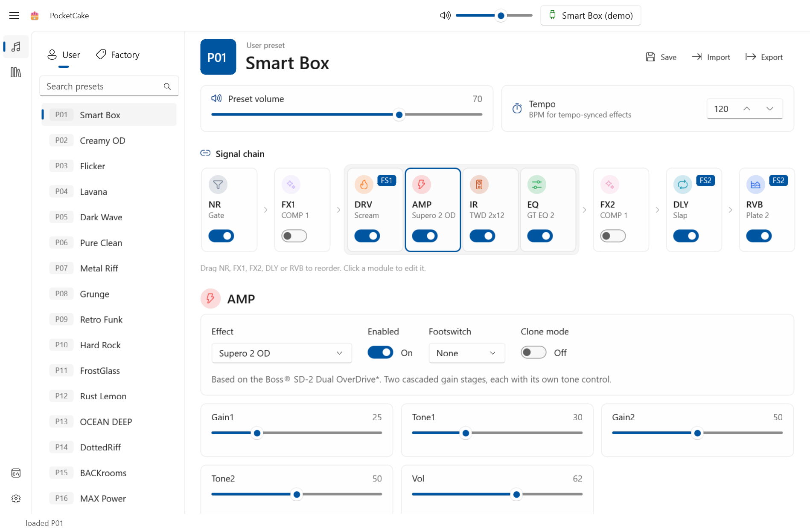

# PocketCake

A native Windows editor for the **Sonicake Pocket Master** and **Sonicake Smart Box**
multi-effects pedals, built with **WinUI 3** and a Fluent (Mica) interface.



## Features

* Real-time, two-way editing over **USB-MIDI** or **Bluetooth LE MIDI** (with auto-reconnect)
* Browse, search and load the Factory and User presets; save to any User slot
* Signal chain view with drag-to-reorder and per-module on/off
* Every effect parameter, effect type picker, FS1/FS2 footswitch assignment, DLY tap tempo
* Preset volume, per-preset BPM and master volume
* Global settings: levels, USB audio mode, re-amp, EXP/FS jack, backlight, ECO, power, factory reset
* User IR upload / rename / clear from `.wav`
* **NAM → .clo** clone-profile conversion and upload
* Preset JSON import / export

## Acknowledgements

The device protocol, data tables and NAM conversion are based on
[SonicMaster](https://github.com/Skyggedans/SonicMaster), whose author reverse-engineered the
pedal's USB-MIDI and BLE protocol. PocketCake ports that work to C# with its own WinUI 3 interface.

## Build & run

Requires the .NET 10 SDK on Windows 10 1904x or later. The app is unpackaged and self-contained
on the Windows App SDK.

```powershell
dotnet test tests/PocketCake.Core.Tests
dotnet run --project src/PocketCake -p:Platform=x64
```

| Path | |
| --- | --- |
| `src/PocketCake.Core` | Platform-free protocol, data tables, decoders, frame builders and the NAM → .clo DSP. |
| `src/PocketCake` | The WinUI 3 app: MIDI / BLE transports, app state, view models and views. |
| `tests/PocketCake.Core.Tests` | xUnit tests, including DSP parity tests against SonicMaster goldens. |

Debug builds can replay real device captures without a pedal by setting `POCKETCAKE_DEMO=1`, and
include a developer console for raw MIDI traffic.

Settings are stored in `%LOCALAPPDATA%\PocketCake\settings.json`; unhandled exceptions are logged to
`crash.log` in the same folder.

## License

MIT. Copyright (c) 2026 An Long; portions ported from SonicMaster, copyright (c) 2026 Andrii Klaptsov.

> Not affiliated with, or endorsed by, Sonicake.
